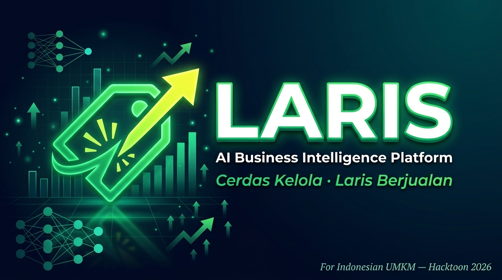

<div align="center">
  
  <br/><br/>
  
  <br/><br/>

[](https://laravel.com)
[](https://php.net)
[](https://ai.google.dev)
[](https://sqlite.org)
[](laris_app/tests)
[](LICENSE)
[](https://github.com/sutan789/Laris-Hacktoon)

<br/>

> **LARIS** — Platform Kecerdasan Bisnis berbasis **Generative AI** yang dirancang khusus untuk UMKM Indonesia.
> Kasir digital · Stok cerdas · Prediksi permintaan · AI Copilot · Marketplace Multi-Gerai — semua dalam satu ekosistem.

<br/>

[🚀 Quick Start](#-quick-start) &nbsp;·&nbsp;
[✨ Fitur](#-fitur-platform) &nbsp;·&nbsp;
[👥 Demo Akun](#-demo-akun) &nbsp;·&nbsp;
[🛠 Tech Stack](#-tech-stack) &nbsp;·&nbsp;
[👨‍💻 Tim](#-tim-pengembang)

</div>

---

## 🌟 Mengapa LARIS?

UMKM Indonesia menghadapi tantangan nyata: **tidak ada data, tidak ada insight, tidak ada keputusan berbasis fakta**. LARIS hadir sebagai solusi:

```
Sebelum LARIS                          Sesudah LARIS
─────────────────────────────────────────────────────────────
❌ Catat stok di buku tulis            ✅ Smart Inventory real-time
❌ Tebak-tebakan produk laku           ✅ AI Predict berbasis data pasar
❌ Laporan bulanan manual              ✅ Executive Summary PDF otomatis
❌ Tidak tahu tren pasar               ✅ Trend Hunter + market intelligence
❌ Chat ke supplier satu-satu          ✅ Kulakan Bareng kolektif otomatis
❌ Tidak ada konsultan bisnis          ✅ Juragan AI Copilot 24/7
```

---

## ✨ Fitur Platform

### 🧠 Juragan AI Copilot
> *Konsultan bisnis AI yang memahami toko Anda*

- Chat interaktif real-time dengan **Google Gemini** (multi-model failover otomatis)
- Injeksi konteks toko otomatis: produk, stok, omzet harian, tren pasar terkini
- Rekomendasi produk cerdas berdasarkan data `market_trends`
- Eksekusi aksi bisnis langsung dari chat: buat Purchase Order, atur diskon, pantau margin
- Bahasa Indonesia natural, bukan bot generic

---

### 📊 Dashboard Juragan (Business Intelligence)
> *Semua angka penting dalam satu layar*

- Live telemetry omzet & transaksi (auto-refresh polling)
- **Radar Chart Peluang Pasar** — 6 dimensi: Trend, Margin, Volume, Competition, Seasonal, Growth
- Operational alerts cerdas: stockout, margin drop, anomali transaksi
- Download **Executive Summary PDF** berdasarkan timeframe pilihan
- Greeting dinamis bahasa Indonesia + visualisasi tanggal otomatis
- IDOR-protected alert resolution (keamanan cross-store)

---

### 🏪 Smart Inventory
> *Stok tidak pernah habis tanpa disadari*

- CRUD produk lengkap: nama, SKU, HPP, harga jual, satuan, kategori, supplier
- Auto-detect **imminent stockout** & **margin drop** dengan threshold dinamis
- **Auto-bundle Purchase Order** ke supplier — satu klik untuk semua item kritis
- **Kulakan Bareng** — pool pembelian kolektif multi-gerai untuk harga grosir lebih murah
- Riwayat reorder & histori stok lengkap

---

### 🔮 LARIS Predict
> *"Bagaimana jika saya jual produk ini?"*

- Simulasi profit & break-even analysis sebelum jual produk baru
- **AI Image Analysis** — foto produk, AI langsung identifikasi & analisis profitabilitas
- Prediksi restock otomatis berbasis pola penjualan historis
- Deep-link URL prefill dari POS Kasir untuk workflow seamless

---

### 🛒 POS Kasir Digital
> *Kasir modern tanpa hardware mahal*

- Cek stok barang **real-time** sebelum setiap transaksi
- Checkout multi-item dengan validasi stok & cross-store product guard
- Cetak **Struk PDF** berbranding toko dalam hitungan detik
- Dashboard kasir tersendiri — role-isolated, hanya fitur yang dibutuhkan
- Riwayat transaksi harian yang bisa difilter

---

### 📈 Trend Hunter
> *Tahu tren sebelum kompetitor*

- Monitor tren pasar dari multiple data source
- Filter berdasarkan kategori & wilayah
- Visualisasi trend curve dengan grafik interaktif
- Integrasi langsung ke Smart Inventory untuk fast-add produk trending

---

### 🛍️ Marketplace Multi-Gerai
> *Toko online UMKM tanpa perlu bikin website sendiri*

- Halaman publik gerai yang bisa diakses tanpa login
- Checkout lengkap: **QRIS**, Transfer Bank, COD
- Voucher diskon, pilihan **delivery/pickup**, estimasi ongkir
- Review & rating produk post-purchase
- **Live order status tracking** real-time untuk pembeli
- Manajemen pesanan terintegrasi untuk pemilik toko

---

### 👑 Super Admin Platform
> *Kontrol penuh atas seluruh ekosistem*

- Kelola semua gerai & user dalam satu dashboard
- Toggle verifikasi gerai & izin delivery
- CRUD user dengan role assignment
- Audit log aktivitas platform

---

## 🏗️ Arsitektur Sistem

```
┌─────────────────────────────────────────────────────────────────────┐
│                          LARIS Platform                             │
│                                                                     │
│  ┌──────────┐  ┌──────────────┐  ┌────────────┐  ┌─────────────┐  │
│  │  Web UI  │  │  Juragan AI  │  │ Inventory  │  │ Marketplace │  │
│  │ Blade +  │  │   Copilot    │  │  & POS     │  │ Multi-Gerai │  │
│  │Alpine.js │  │ Gemini API   │  │ Smart Stock│  │ QRIS+Voucher│  │
│  └──────────┘  └──────────────┘  └────────────┘  └─────────────┘  │
│  ──────────────────────────────────────────────────────────────     │
│                    Laravel 11 Application Core                      │
│    Controllers · Services · Middleware · Policies · Route Guards    │
│  ──────────────────────────────────────────────────────────────     │
│  ┌────────────┐  ┌──────────────┐  ┌──────────┐  ┌────────────┐   │
│  │  SQLite DB │  │ PDF (DomPDF) │  │Telemetry │  │  Role Auth │   │
│  │  + Migrate │  │ Struk+Report │  │   API    │  │ Middleware  │   │
│  └────────────┘  └──────────────┘  └──────────┘  └────────────┘   │
└─────────────────────────────────────────────────────────────────────┘
```

---

## 🚀 Quick Start

### Prerequisites

| Requirement | Version |
|-------------|---------|
| PHP | >= 8.2 |
| Composer | >= 2.x |
| SQLite Extension | Enabled |
| XAMPP / Laragon | Latest |

### Instalasi 3 Menit

```bash
# Step 1 — Clone repo
git clone https://github.com/sutan789/Laris-Hacktoon.git
cd Laris-Hacktoon/laris_app

# Step 2 — Install dependencies PHP
composer install

# Step 3 — Environment setup
cp .env.example .env
php artisan key:generate

# Step 4 — Database (SQLite sudah tersedia dan berisi data demo!)
# Tidak perlu migrate jika menggunakan database.sqlite yang disertakan.
# Jika ingin fresh install:
php artisan migrate

# Step 5 — Storage symlink
php artisan storage:link

# Step 6 — Jalankan!
php artisan serve
```

**Buka:** `http://127.0.0.1:8000` — langsung login dengan akun demo di bawah!

### Aktifkan Juragan AI

```env
# Di file laris_app/.env
GEMINI_API_KEY=your_gemini_api_key_here
AI_MODEL=gemini-2.0-flash-lite
```

Dapatkan API Key gratis di [Google AI Studio](https://aistudio.google.com/apikey).

---

## 👥 Demo Akun

| Role | Email | Password | Fitur Utama |
|------|-------|----------|-------------|
| 👑 **Super Admin** | `admin@laris.id` | `password` | Kelola semua gerai, user, verifikasi |
| 🏪 **Juragan / Owner** | `owner@laris.id` | `password` | Dashboard BI, Juragan AI, Laporan PDF |
| 🧾 **Kasir** | `kasir@laris.id` | `password` | POS Checkout, Cek Stok, Struk PDF |
| 📦 **Staff Gudang** | `gudang@laris.id` | `password` | Smart Inventory, LARIS Predict |
| 🛍️ **Pembeli** | `pembeli@laris.id` | `password` | Marketplace, Checkout, Order Tracking |

---

## 🔐 Keamanan Platform

| Proteksi | Detail |
|----------|--------|
| **IDOR Protection** | Alert & order cross-store diblokir dengan 403 |
| **Role-Based Middleware** | Setiap route diproteksi dengan `role:owner,staff_cashier` etc |
| **Duplicate POST Guard** | Cegah eksekusi aksi ganda pada alert resolution |
| **Stock Validation** | Validasi stok real-time sebelum setiap checkout |
| **Secret History Clean** | API key di-sanitize dari seluruh commit history |
| **Auth Guards** | Laravel standard auth + custom `EnsureUserRole` middleware |

---

## 🧪 Test Suite

```bash
cd laris_app
php artisan test
```

```
   PASS  Tests\Feature\BugHunterSecurityAndIntegrityTest   (15 tests)
   PASS  Tests\Feature\ResponsiveAndViewsTest               (16 tests)
   PASS  Tests\Feature\SettingsTest                         (1 test)
   PASS  Tests\Unit\ExampleTest                             (1 test)
   PASS  Tests\Feature\ExampleTest                          (1 test)

  Tests:    34 passed (213 assertions)
  Duration: 1.68s
```

Coverage: Security IDOR, Role Access, POS Checkout, PDF Export, AI Endpoints, Marketplace Flow, Settings.

---

## 🛠️ Tech Stack

| Layer | Teknologi |
|-------|-----------|
| **Backend Framework** | Laravel 11 (PHP 8.2+) |
| **Frontend Templating** | Blade + Alpine.js |
| **Data Visualization** | Chart.js (Line, Radar, Bar) |
| **Database** | SQLite (siap pakai) / MySQL compatible |
| **AI Engine** | Google Gemini API — gemini-2.0-flash-lite + multi-model failover |
| **PDF Generation** | DomPDF (barryvdh/laravel-dompdf) |
| **Authentication** | Laravel Auth + EnsureUserRole Middleware |
| **Styling** | Custom CSS — Dark Theme, Glassmorphism, Animations |
| **Testing** | PHPUnit via Laravel Test (34 tests, 213 assertions) |
| **Video Background** | HTML5 Video (ambient topographic loop) |

---

## 📁 Struktur Proyek

```
Laris-Hacktoon/
├── 🎨 banner.jpg                        ← Hero banner README
├── 🏷️ logo.png                          ← LARIS logo
├── 📄 README.md
│
└── 📁 laris_app/                        ← Aplikasi Laravel utama
    ├── 📁 app/Http/Controllers/         ← 12+ Controllers terpisah per fitur
    │   ├── AuthController.php
    │   ├── DashboardController.php      ← BI Dashboard + Telemetry + PDF
    │   ├── JuraganAiController.php      ← Gemini AI Chat + Action Execute
    │   ├── InventoryController.php      ← Smart Inventory + Kulakan Bareng
    │   ├── PosController.php            ← POS Checkout + Receipt PDF
    │   ├── PredictController.php        ← LARIS Predict + Image Analysis
    │   ├── TrendController.php          ← Trend Hunter
    │   ├── ReportController.php         ← Business Report + WhatsApp Export
    │   ├── UserMarketplaceController.php← Marketplace + Order Management
    │   ├── SuperAdminController.php     ← Super Admin Platform
    │   ├── RoleDashboardController.php  ← Role-Separated Dashboards
    │   └── SettingsController.php       ← Store & AI Settings
    │
    ├── 📁 app/Services/
    │   ├── AiService.php                ← Gemini API + failover logic
    │   ├── OrderService.php             ← Order processing & stock deduction
    │   └── PosTelemetryService.php      ← Live telemetry calculation
    │
    ├── 📁 resources/views/
    │   ├── 📁 auth/                     ← Login (ambient video background)
    │   ├── 📁 pages/                    ← 15+ halaman fitur
    │   ├── 📁 reports/                  ← Executive Summary PDF, Struk PDF
    │   └── 📁 partials/                 ← Komponen reusable (alerts, etc)
    │
    ├── 📁 database/
    │   ├── database.sqlite              ← SQLite DB berisi data demo
    │   └── 📁 migrations/              ← 10+ migration files
    │
    └── 📁 tests/                        ← 34 tests, 213 assertions
        └── 📁 Feature/
            ├── BugHunterSecurityAndIntegrityTest.php
            ├── ResponsiveAndViewsTest.php
            └── SettingsTest.php
```

---

## 🗺️ Roadmap

```
Phase 1 — DONE (Hacktoon 2026)
  ✅ Juragan AI Copilot (Gemini Integration)
  ✅ Real-time Dashboard BI
  ✅ Smart Inventory + Auto-bundle
  ✅ POS Kasir Digital
  ✅ LARIS Predict
  ✅ Marketplace Multi-Gerai
  ✅ Super Admin Platform
  ✅ 34 Automated Tests

Phase 2 — Coming Soon
  🔲 Google Trends & GA4 live data integration
  🔲 Tokopedia & Shopee webhook sync
  🔲 TikTok Shop affiliate pipeline
  🔲 QRIS live payment gateway (Midtrans/Xendit)
  🔲 Progressive Web App (PWA)
  🔲 Geo-proximity heatmap toko
  🔲 WhatsApp Business API notification
```

---

## 👨‍💻 Tim Pengembang

<div align="center">

|  | Nama | GitHub | Role |
|--|------|--------|------|
|  | **Sutan Aziz Irvan** | [@sutan789](https://github.com/sutan789) | Lead Developer · AI Integration · Backend |
|  | **Napwoy** | [@Napwoy](https://github.com/Napwoy) | Backend Architecture · Database Design |

*Dibuat dengan semangat untuk memajukan UMKM Indonesia melalui teknologi AI*

</div>

---

## 🤝 Kontribusi

Tertarik berkontribusi? Kami menyambut tangan terbuka!

```bash
# 1. Fork repo ini
# 2. Buat branch fitur
git checkout -b feat/nama-fitur

# 3. Commit dengan conventional commits
git commit -m "feat: tambah fitur keren"

# 4. Push & buat Pull Request
git push origin feat/nama-fitur
```

Baca [CONTRIBUTING.md](CONTRIBUTING.md) untuk panduan lengkap (segera hadir).

---

## 📄 Lisensi

MIT License — bebas digunakan, dimodifikasi, dan didistribusikan.
Lihat [LICENSE](LICENSE) untuk detail lengkap.

---

<div align="center">


### Dibuat dengan ❤️ untuk 64 Juta UMKM Indonesia

*"Setiap juragan berhak punya asisten AI kelas enterprise"*

[](https://github.com/sutan789/Laris-Hacktoon)
[](https://github.com/sutan789/Laris-Hacktoon/fork)
[](https://github.com/sutan789/Laris-Hacktoon/issues)

**Hacktoon 2026 — LARIS Team**

</div>
