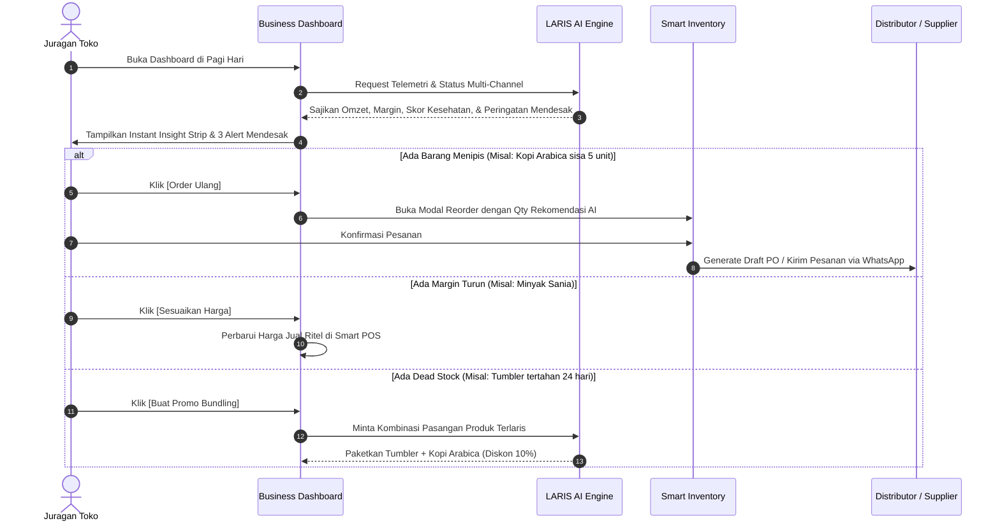
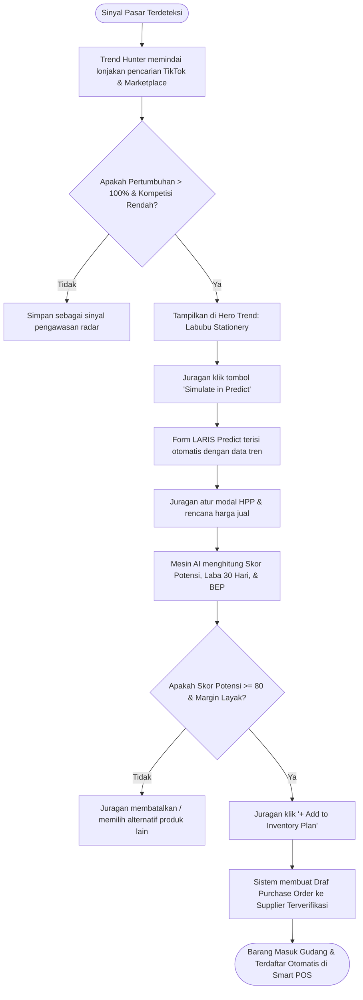
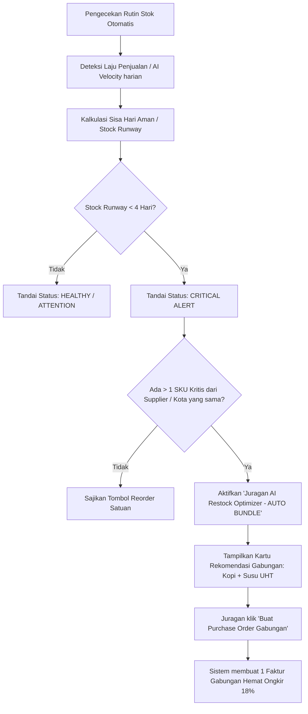
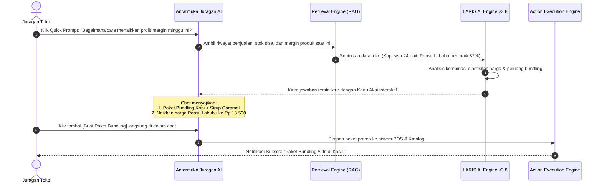

# Product Requirements Document (PRD)
## Proyek: LARIS (AI Business Intelligence & Decision Platform for MSMEs)
### Tim Pengembang: Meukarya Team (INFEST Hackathon 2026)
### Dokumen Kebutuhan Produk & Spesifikasi Alur Kerja (Workflow)
### Versi: 2.0.0 | Status: Siap Implementasi (Approved for Production & Prototype)

---

## 1. Ringkasan Eksekutif (Executive Summary)
**LARIS** adalah platform *AI Business Intelligence & Decision Support System* terintegrasi yang dirancang khusus bagi pelaku UMKM ritel mandiri, toko kelontong, F&B, dan toko daring (online seller). LARIS mengubah paradigma aplikasi POS konvensional dari sekadar pencatat buku kasir reaktif menjadi **"Business Brain"** (otak bisnis cerdas) proaktif yang mengawinkan data internal toko (penjualan, inventory, modal) dengan sinyal pasar eksternal (tren media sosial, volume pencarian lokal, pergerakan kompetitor).

Tujuan intinya adalah memampukan pemilik usaha kecil mengambil keputusan bisnis yang terukur, dapat dijelaskan (*Explainable AI*), dan dapat dieksekusi secara instan dengan satu kali klik.

---

## 2. Masalah Bisnis & Peluang Nyata (Problem & Opportunity)

### 2.1 Poin Masalah (Pain Points) Pelaku UMKM
1. **Data Rich, Insight Poor:** Banyak toko telah memiliki ribuan data transaksi digital (lewat QRIS & aplikasi kasir), namun pemilik toko tidak tahu barang mana yang menghasilkan laba sejati versus barang yang hanya menahan modal.
2. **Jeratan Dead Stock & Cash Flow Mandek:** Pemilik toko membelanjakan modal kerja (*working capital*) pada stok yang lambat bergerak (*slow-moving*), sehingga kehabisan likuiditas saat produk populer datang.
3. **Risiko Stockout pada Momen Emas:** Kehilangan 20-40% potensi omzet karena telat memesan kembali (*reorder*) produk yang sedang viral atau mengalami lonjakan permintaan musiman.
4. **Terjebak Tren FOMO:** Menjual barang viral tanpa memperhitungkan radius pasar lokal, kapasitas modal, atau margin riil setelah dipotong biaya operasional.

### 2.2 Nilai Proposisi LARIS (Value Proposition)
> *"LARIS memahami bisnis Anda, membaca pasar sekitar, memprediksi kemungkinan, menjelaskan alasannya, dan menyiapkan tombol aksi nyata."*

* The Closed Intelligence Loop:
  $$\text{Transaksi POS} \longrightarrow \text{Koleksi Data} \longrightarrow \text{AI Reasoning Engine} \longrightarrow \text{Insight Strategis} \longrightarrow \text{Keputusan Terbimbing} \longrightarrow \text{Eksekusi 1-Klik}$$

---

## 3. Profil Pengguna & Persona (User Persona)

| Atribut | Persona Utama (Juragan Toko Mandiri) | Persona Sekunder (Kasir & Staf Gudang) |
| :--- | :--- | :--- |
| **Profil Contoh** | **Juragan Bambang (42 Tahun)**, Pemilik Toko Ritel Berkah Utama | **Rian (21 Tahun)**, Kasir & Pengelola Stok Toko |
| **Tanggung Jawab** | Mengatur kulakan barang, arus kas, menentukan harga jual, strategi promo | Melayani pembeli di kasir, mencatat barang masuk dari kurir distributor |
| **Kebutuhan Utama** | Tahu barang apa yang harus dibeli minggu ini, berapa margin amannya, cara naikin omzet | Antarmuka kasir cepat tanpa loading, notifikasi stok menipis otomatis |
| **Pain Points** | Pusing melihat grafik rumit, takut uang kas habis karena barang gak laku | Ribet hitung stok manual, bingung kapan harus telepon distributor |

---

## 4. Kebutuhan Fitur Terperinci (Detailed Feature Specifications)

### 4.1 Modul 1: Live Telemetry & Business Dashboard
* **Tujuan:** Menjadi ruang kendali harian pemilik usaha saat memulai aktivitas bisnis di pagi hari.
* **Fitur Utama:**
  - **Live Telemetry Header:** Menampilkan status sinkronisasi multi-channel (Shopee, Tokopedia, Toko Offline) secara real-time.
  - **Top 4 KPI Metrics:**
    - Omzet Hari Ini (dengan sparkline tren vs kemarin).
    - Estimasi Laba Bersih & Margin Profit Aktual (%).
    - Skor Kesehatan Stok Gudang (persentase SKU aman vs perlu reorder).
    - Skor Peluang Pasar (Opportunity Score 0-100 & deteksi sinyal tren baru).
  - **Instant Insight Strip (Top Banner):** Rekomendasi prioritas hari ini yang didukung tombol aksi instan `[Eksekusi Rekomendasi]`.
  - **Opportunity Radar (Circular Scanner):** Visualisasi sebaran peluang produk viral vs normal di radius area toko pengguna.
  - **Pusat Peringatan Operasional (Operational Alerts):** Deteksi 3 kategori risiko mendesak:
    1. *Imminent Stockout* (habis dalam hitungan jam/hari).
    2. *Margin Erosion* (harga distributor naik, rekomendasi menaikkan harga jual ritel).
    3. *Dead Stock Stagnant* (barang tertahan > 20 hari, rekomendasi paket promo bundling).

### 4.2 Modul 2: LARIS Predict ("What If I Sell This?")
* **Tujuan:** Mesin simulasi kelayakan produk baru agar juragan tidak spekulasi saat belanja modal.
* **Spesifikasi Input:**
  - Nama Produk Rencana (teks bebas / integrasi kata kunci tren).
  - Kategori Tren Pasar (dropdown kategori).
  - Parameter Finansial: Modal/HPP (Rp) dan Rencana Harga Jual (Rp).
  - Otomasi Kalkulasi Gross Margin (% dan nominal laba kotor per unit).
  - Target Saluran Jual (Multi-checkbox: Shopee, TikTok Shop, Tokopedia, Offline Store).
  - Pilihan Batch Stok Awal (10 pcs Trial, 50 pcs Recommended, 100 pcs Scale, 250 pcs Grosir).
* **Spesifikasi Output AI:**
  - **Skor Potensi Produk (1-100)** didampingi **Tingkat Keyakinan (Confidence %)**.
  - **Estimasi Permintaan Awal:** Rentang unit terjual dalam 14 hari pertama.
  - **Proyeksi Finansial:** Total Revenue & Estimasi Laba Bersih.
  - **Grafik Dynamic Lintasan 30 Hari:** Menunjukkan titik impas (BEP) dan titik laba optimal.
  - **Key Insights & Rekomendasi Juragan AI:** Menampilkan peluang lokal, kecepatan viralitas TikTok, serta saran bundling pendongkrak AOV (*Average Order Value*).
  - **Tombol Aksi:** `[Save Simulation]`, `[Export Report]`, dan `[+ Add to Inventory Plan]`.

### 4.3 Modul 3: Trend Hunter (Radar Tren Pasar AI)
* **Tujuan:** Mendeteksi lonjakan permintaan konsumen sebelum pasar menjadi jenuh dan terjadi perang harga.
* **Fitur Utama:**
  - **Filter Temporal:** 7 Hari Terakhir, 30 Hari, 90 Hari.
  - **Hero Trend Card (Fokus Utama):**
    - Identifikasi Siklus Tren: *Early Stage* (Waktu masuk optimal), *Growth Stage*, atau *Mature/Declining Stage*.
    - Sinyal Kekuatan Tren (Signal Strength %).
    - Growth Velocity (% kenaikan pencarian WoW di TikTok & E-Commerce).
    - Rata-rata Rentang Harga Pasar & Defisit Stok Nasional.
    - Kurva Akselerasi Tren (Data Historis vs Prediksi AI 7 Hari ke Depan).
    - Tombol Tindakan Cepat: `[Eksekusi Restock ->]`.
  - **Matriks Produk Tren (Grid Card):** Menampilkan produk turunan dengan sparkline tren, status siklus, dan tombol satu klik `[Simulate in Predict]`.

### 4.4 Modul 4: Smart Inventory & Restock Automation
* **Tujuan:** Menghilangkan stok mati, mencegah kehabisan barang, dan mengotomasi draf pemesanan barang ke distributor.
* **Fitur Utama:**
  - **Emergency Banner (Imminent Stockout):** Menyorot produk paling kritis dengan estimasi habis dan rekomendasi jumlah restock ke supplier terkait.
  - **Ringkasan Kesehatan Inventaris:** Pembagian porsi SKU (*85% Healthy*, *10% Attention*, *5% Critical Alert*).
  - **Tabel Matriks Inventaris:**
    - Kolom: Nama Produk, SKU, Kategori, Stok Tersisa, Status Kesehatan, AI Velocity (laju penjualan unit/hari), Stock Runway (estimasi sisa hari aman), Quick Action.
  - **Juragan AI Restock Optimizer (Auto-Bundle Engine):**
    - Mendeteksi produk kritis dari supplier yang sama.
    - Tombol `[Buat Purchase Order Gabungan]` untuk menghemat biaya ongkos kirim dan mencegah potensi kerugian penjualan (*lost sales*).

### 4.5 Modul 5: Juragan AI (Asisten Percakapan Copilot)
* **Tujuan:** Konsultan bisnis personal berbasis LLM + RAG yang memahami seluruh basis data internal toko pengguna.
* **Fitur Utama:**
  - Widget Profil Juragan & Metrik Finansial Cepat (Omzet & Rata-rata Margin).
  - Quick Topic Chips: *Analisis Omzet Bulan Ini, Cek Produk Menjelang Habis, Rekomendasi Flash Sale, Catat Transaksi Offline via Voice/Foto Struk*.
  - Riwayat Konsultasi Strategis Terarsip.
  - **Rich Interactive AI Response:** Jawaban tidak hanya berupa teks, melainkan menyajikan kartu tindakan interaktif (kartu produk, perbandingan elastisitas harga, tombol buat paket bundling, dan tombol buka simulator).

### 4.6 Modul 6: Business Report (Monthly Business Review)
* **Tujuan:** Audit performa bisnis bulanan komprehensif bagi pemilik toko dan kebutuhan pelaporan pembiayaan.
* **Fitur Utama:**
  - 4 Kartu Metrik Eksekutif: Total Revenue (MoM), Net Profit (MoM), Beban Operasional (Opex), Rata-rata Skor Peluang AI.
  - Visualisasi Pertumbuhan Mingguan (Gross Revenue vs Net Profit).
  - Distribusi Saluran Penjualan (Shopee, Tokopedia, Toko Offline).
  - Donut Chart Portofolio SKU (Produk Champion vs Dead Stock tertahan).
  - **Ringkasan Evaluasi Eksekutif:** Catatan validasi rekomendasi AI bulan lalu dan rencana aksi bulan depan.
  - Tombol Integrasi: `[Kirim Ringkasan via WhatsApp]` & `[Unduh PDF/Excel]`.

---

## 5. Alur Kerja Sistem (End-to-End System Workflows)

Berikut adalah 4 alur kerja utama (*core workflows*) yang menggambarkan bagaimana pengguna dan sistem AI berinteraksi:

### 5.1 Workflow 1: Alur Kerja Harian Juragan (Daily Morning Routine & Decision Loop)

---

### 5.2 Workflow 2: Alur Penemuan Tren hingga Eksekusi Kulakan (Trend-to-Restock Workflow)

---

### 5.3 Workflow 3: Alur Otomasi Restock & Penggabungan PO (Smart Inventory Auto-Bundle)

---

### 5.4 Workflow 4: Alur Konsultasi & Eksekusi Strategi di Juragan AI (Consultative Copilot Workflow)

---

## 6. Kebutuhan Non-Fungsional (Non-Functional Requirements)

1. **Kecepatan & Responsivitas (Performance):**
   - Transaksi kasir POS harus diproses < 150 ms.
   - Hasil kalkulasi simulator *LARIS Predict* disajikan maksimal dalam 1.8 detik.
   - Respon chat *Juragan AI* mulai memunculkan token pertama (*TTFT*) < 1.2 detik.
2. **Keandalan & Integritas Data (Data Reliability):**
   - Mendukung pencatatan stok atomik (*ACID compliance*) agar tidak terjadi *overselling* saat ada transaksi simultan di kasir offline dan pesanan online marketplace.
3. **Kemampuan Berjalan Offline (Offline-First POS):**
   - Kasir tetap dapat memindai barang dan mengeluarkan struk meskipun internet padam. Data transaksi akan otomatis di-*sync* ke AI Cloud begitu koneksi tersambung kembali.
4. **Keamanan & Privasi (Security & Privacy):**
   - Data finansial dan rahasia dagang toko diisolasi (*multi-tenant security*).
   - Seluruh sinyal data pasar yang dikumpulkan dari komunitas UMKM dianonimkan tanpa mengekspos identitas toko individual.

---

## 7. Spesifikasi Arsitektur Teknologi & Tech Stack

Aplikasi LARIS dikembangkan dengan arsitektur monolitik modern yang tangguh, cepat di-deploy, dan mudah dirawat:

### 7.1 Backend: Laravel (PHP Framework)
* **Framework:** **Laravel 11.x / 12.x (PHP 8.2+)**
* **Peran & Tanggung Jawab:**
  - Mengelola logika bisnis utama (*core business logic*), autentikasi pengguna/toko (multi-tenant role & permission).
  - Menyediakan *Controller*, *Service Layer*, dan *Repository Pattern* untuk perhitungan omzet, margin kotor, HPP, serta kalkulasi inventaris.
  - Menjalankan *AI Intelligence Bridge Service*: Berkomunikasi dengan model AI/LLM API untuk simulasi *LARIS Predict*, klasifikasi tren, dan chat copilot *Juragan AI*.
  - Mengelola *Background Jobs & Queues* (Laravel Queue) untuk sinkronisasi telemetri pesanan marketplace dan pemrosesan draf restock tanpa memperlambat interaksi pengguna.

### 7.2 Frontend: Laravel Blade Templating Engine
* **View Engine:** **Laravel Blade (`resources/views/**/*.blade.php`)**
* **Peran & Tanggung Jawab:**
  - Server-Side Rendering (SSR) yang ringan, cepat dimuat oleh browser perangkat kasir sederhana maupun smartphone.
  - Memanfaatkan *Blade Components* yang modular dan dapat digunakan kembali (*reusable*):
    - `<x-sidebar>` (Navigasi gelap konsisten dengan menu aktif)
    - `<x-topbar>` (Pencarian universal, status live sync toko, profil juragan)
    - `<x-metric-card>` (Kartu metrik omzet, margin, kesehatan stok dengan sparkline)
    - `<x-alert-banner>` (Peringatan operasional & instant insight banner)
    - `<x-trend-card>` & `<x-modal-action>`
  - Didukung Vanilla CSS / Tailwind CSS dan JavaScript ringan (Alpine.js / Vanilla JS) untuk penanganan interaksi dinamis seperti kalkulasi instan di form simulator *LARIS Predict*, tab switcher, dan streaming chatbox *Juragan AI*.

### 7.3 Basis Data (Database): MySQL
* **Database Engine:** **MySQL 8.0+ (InnoDB Engine)**
* **Peran & Tanggung Jawab:**
  - Menjamin integritas transaksi stok dan penjualan dengan dukungan penuh transaksi atomik (**ACID Compliance**).
  - Skema database relasional terstruktur:
    - `users` & `stores` (Profil toko, modal kerja, preferensi risiko, lokasi pasar)
    - `products` (Katalog barang, SKU, barcode, kategori, HPP/harga modal, harga jual, minimum threshold)
    - `inventories` & `inventory_logs` (Pencatatan pergerakan stok, AI velocity harian, lead-time supplier)
    - `transactions` & `transaction_items` (Riwayat transaksi POS multi-channel: offline, Shopee, Tokopedia)
    - `suppliers` & `purchase_orders` (Data pemasok, draf PO hasil rekomendasi restock AI)
    - `market_trends` & `prediction_simulations` (Data sinyal tren radar, riwayat simulasi "What If I Sell This?", log konsultasi Juragan AI).
  - Penggunaan indexing yang optimal pada `store_id`, `created_at`, dan `sku` guna memastikan query analitik dashboard selesai dalam hitungan milidetik.

---

## 8. Metrik Keberhasilan & OKR Produk (Success Metrics)

| Metrik | Target Awal (MVP) | Target Jangka Panjang (6 Bulan) |
| :--- | :--- | :--- |
| **Tingkat Adopsi Aksi (Action Acceptance Rate)** | $\ge 50\%$ rekomendasi dashboard dieksekusi | $\ge 70\%$ rekomendasi dieksekusi |
| **Penurunan Dead Stock** | Menurun 20% dalam 45 hari | Menurun 35-45% dalam 90 hari |
| **Pencegahan Kehabisan Barang (Stockout Prevention)** | Insiden stockout barang terlaris < 8% | Insiden stockout barang terlaris < 3% |
| **Keterlibatan Pengguna (Weekly Active Days)** | 3 hari per minggu dibuka juragan | 5-6 hari per minggu dibuka juragan |
| **Rata-rata Margin Improvement** | Kenaikan margin kotor rata-rata +2.5% | Kenaikan margin kotor rata-rata +5.8% |

---

## 9. Rencana Implementasi & Roadmap Pengembangan

* **Fase 1 (MVP Hackathon INFEST 2026):**
  - Setup fondasi project **Laravel, Blade Views, dan Database MySQL**.
  - Implementasi 6 layar utama Blade sesuai mockup desain di *disan.md*.
  - Integrasi controller dan model Eloquent untuk kalkulasi analitik serta simulasi *LARIS Predict*.
  - Prototipe chatbot *Juragan AI* dengan respon interaktif.
* **Fase 2 (Automated Connectors):**
  - Integrasi API resmi e-commerce lokal (Shopee Open API, Tokopedia API).
  - Modul OCR kamera HP untuk pindai struk belanja kulakan dan nota fisik.
* **Fase 3 (B2B Supply & Financing Ecosystem):**
  - Koneksi langsung ke distributor FMCG & supplier grosir lokal untuk pengiriman otomatis PO.
  - Integrasi skor kesehatan bisnis LARIS dengan lembaga perbankan untuk percepatan pengajuan Kredit Usaha Rakyat (KUR) tanpa agunan fisik berbelit.
