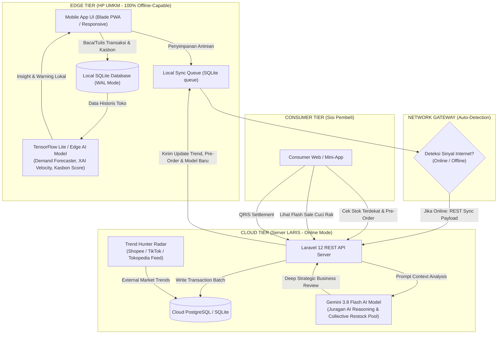

# Product Requirements Document (PRD)

## Project: LARIS (AI Business Intelligence & Inclusive Decision Platform for MSMEs)
**Theme:** *AI for All: Intelligent Solutions for an Equitable Future*  
**Author:** Senior Product Manager & Tech Lead (Meukarya Team — INFEST Hackathon 2026)  
**Status:** Approved for Production & Hackathon MVP Execution  
**Version:** 3.5.0 (Enterprise-Grade Two-Sided & Inclusive Edition)  

---

## 1. OVERVIEW & OBJECTIVES

### 1.1 Visi Produk
Menjadi **"Business Brain & Local Commerce Ecosystem"** paling inklusif di Indonesia yang mendemokratisasikan kecerdasan buatan (*Artificial Intelligence*) bagi 65 juta pelaku UMKM—dari warung kelontong pelosok daerah 3T (Tertinggal, Terdepan, Terluar) tanpa sinyal stabil, hingga ritel modern perkotaan—sekaligus menghubungkannya secara langsung, adil (*equitable*), dan transparan dengan konsumen sekitar serta jaringan distributor pangan nasional.

### 1.2 Problem Statement
1. **Asymmetric Intelligence & Blind Procurement:** 87% pemilik warung/toko ritel membeli stok baru secara spekulatif (*feeling-based*), menyebabkan estimasi kerugian nasional hingga Rp 42 Triliun per tahun akibat *dead stock* (barang basi/mati) dan *stockout* (kehilangan pembeli karena stok kosong).
2. **The 3T Connectivity Penalty:** Solusi SaaS kasir konvensional mengasumsikan internet selalu menyala. Di lebih dari 38% titik pelosok Indonesia, saat sinyal padam, sistem kasir online lumpuh total dan operasional terpaksa kembali ke buku tulis manual yang rentan hilang atau rusak.
3. **The Unrecorded "Kasbon" Economy:** 30% - 50% perputaran barang di warung akar rumput terjadi lewat utang pelanggan (kasbon). Tanpa pencatatan digital dan analisis risiko kredit, modal kerja UMKM sering kali mandek dan berujung gulung tikar.
4. **Supply Chain Inequity (Kalah Skala Kulakan):** Warung kecil pelosok selalu membeli barang dengan harga grosir mahal dari perantara tingkat 3-4, kalah bersaing hingga 15-20% margin dari ritel modern waralaba.
5. **Food Waste & Disconnected Consumer:** Konsumen sekitar sering kecewa saat barang di warung kosong, sementara di sisi lain warung sering membuang produk F&B/roti yang kedaluwarsa karena tidak ada sistem cuci rak (*clearance sale*) real-time ke warga sekitar.

### 1.3 Key Success Metrics (Hackathon Demo Target)
| Metrik | Target Evaluasi Juri | Mekanisme Pengukuran Demo |
| :--- | :--- | :--- |
| **Offline-First Resilience** | **100% Berfungsi Tanpa Internet** | Demo transaksi kasir, kalkulasi stok lokal, dan pencatatan kasbon pada mode pesawat (*Airplane Mode*). |
| **Instant Local Inference** | **< 150 ms** Latency Edge AI | Waktu inferensi lokal model TensorFlow Lite Micro pada chipset HP low-end. |
| **Seamless Cloud Sync** | **Zero Data Loss & < 3s Sync** | Sinkronisasi antrean transaksi lokal ber-UUID saat koneksi internet kembali aktif. |
| **Explainable AI (XAI)** | **100% Rekomendasi Disertai Alasan** | Setiap saran stok, auto-bundle, dan kredit kasbon wajib memiliki *Confidence Score* dan penjelasan *WHY*. |
| **Two-Sided Engagement** | **End-to-End Loop Selesai** | Simulasi pembeli melakukan *Pre-Order* &rarr; warung kulakan bareng &rarr; flash sale cuci rak &rarr; checkout QRIS. |

---

## 2. TARGET USER & USER PERSONA

### 2.1 Persona 1: Pemilik UMKM di Daerah 3T (The Underserved Merchant)
* **Nama:** Pak Wayan Subekti (51 Tahun)
* **Role / Usaha:** Pemilik Toko Kelontong "Sari Rejeki", Lombok Utara (Zona Blankspot)
* **Karakteristik & Perangkat:** Menggunakan Android low-end (RAM 3GB), kuota internet terbatas, sinyal seluler hanya muncul kuat di malam hari atau saat pergi ke pasar kecamatan. Sering melayani dengan dialek lokal.
* **Pain Points:** 
  - Catatan utang kasbon warga sering lupa dicatat atau hilang bukunya, nominal macet mencapai jutaan rupiah.
  - Sering kehabisan minyak goreng dan susu bayi saat wisatawan/warga datang, tetapi di sisi lain tumpukan biskuit kaleng sudah 3 bulan berdebu tidak laku.
  - Aplikasi kasir online lain tidak bisa dibuka jika kuota habis atau sinyal drop.
* **Kebutuhan Utama:**
  - Aplikasi kasir yang **tetap jalan offline 100%**.
  - Peringatan stok cerdas di HP tanpa perlu internet: *"Pak, minyak tinggal 3 pouch, habis 2 hari lagi!"*
  - Pencatatan transaksi cepat dengan suara (*Voice Input*) yang mengerti bahasa daerah santai.
  - Buku kasbon digital dengan pengingat tagihan otomatis via WhatsApp.

### 2.2 Persona 2: Pembeli / Konsumen Modern (The Connected Local Consumer)
* **Nama:** Amanda Putri (24 Tahun)
* **Role:** Mahasiswi / Pekerja Lepas, tinggal di area sub-urban
* **Karakteristik:** Digital-native, mengutamakan kepraktisan, pengguna setia QRIS dan e-wallet.
* **Pain Points:**
  - Lelah bolak-balik mendatangi 3 warung sekitar indekos hanya untuk mencari barang tertentu (misal: camilan viral, obat maag, atau galon air) dan ternyata semuanya kosong.
  - Tidak tahu kisaran harga pasti warung kelontong sebelum datang ke lokasi.
  - Sering melewatkan promo makanan/roti yang sebenarnya sedang diobral murah sebelum warung tutup.
* **Kebutuhan Utama:**
  - Aplikasi pencarian stok terdekat secara real-time (*Nearby Stock Finder*).
  - Fitur **Pre-Order (Titip Kulakan)** jika barang di warung langganan sedang kosong.
  - Notifikasi promo cuci rak sore/malam hari (*Clearance Flash Sale*) untuk berhemat.

---

## 3. CORE FEATURES (FITUR UTAMA LENGKAP & INTEGRATIF)

Platform LARIS dirancang sebagai **Two-Sided Inclusive Ecosystem** dengan modul-modul berikut:

```
+-----------------------------------------------------------------------------------+
|                            LARIS TWO-SIDED PLATFORM                               |
+-----------------------------------------+-----------------------------------------+
|        SISI 1: PEMILIK UMKM             |           SISI 2: KONSUMEN              |
|          (Business Brain)               |          (Local Marketplace)            |
+-----------------------------------------+-----------------------------------------+
|  1. Smart POS Offline & Voice Multi-Bhs |  1. LARIS Nearby Stock Finder           |
|  2. Smart Kasbon & AI Repayment Score   |  2. Guaranteed Local Pre-Order          |
|  3. Smart Inventory & Auto-Bundle       |  3. Flash Sale Cuci Rak (Anti-Basi)     |
|  4. Kulakan Bareng (B2B Group Buying)   |  4. Smart QRIS Pay & Dynamic Loyalty    |
|  5. LARIS Predict ("What If I Sell?")   |                                         |
|  6. Juragan AI Copilot (XAI Reasoning)  |                                         |
|  7. Bi-Directional Cloud Sync Engine    |                                         |
+-----------------------------------------+-----------------------------------------+
```

### 3.1 Sisi 1: Aplikasi Pemilik UMKM (Business Brain)

#### 1. Smart POS (Point of Sale Offline & Multi-Dialect Voice)
* **Fungsi:** Mesin kasir kilat yang bekerja 100% tanpa internet.
* **Peran AI:**
  - **Dialect-Aware Voice-to-Receipt:** Mengenali percakapan kasir dalam Bahasa Indonesia maupun istilah daerah (*"Kopi ireng siji, udud kretek loro"* &rarr; diparsing menjadi: *1 Kopi Hitam, 2 Rokok Kretek*).
  - **Dynamic Basket Recommender:** AI menganalisis isi keranjang dan merekomendasikan produk pelengkap bernilai tinggi (*cross-selling*).
* **Mode Offline:** Data transaksi disimpan lokal secara atomic di SQLite dan stok terpotong seketika.

#### 2. Smart Kasbon & AI Credit Risk Scoring (Buku Utang Digital)
* **Fungsi:** Pencatatan utang/piutang pelanggan warung dengan analisis kelayakan bayar.
* **Peran AI:**
  - **Repayment Probability Score (0 - 100%):** Memprediksi kedisiplinan bayar pelanggan berdasarkan riwayat pelunasan masa lalu (*"Pak Bambang: Skor Kelayakan 92%, disarankan batas kasbon maksimal Rp 250.000"*).
  - **1-Click WhatsApp Polite Reminder:** AI merangkai draf pesan pengingat tagihan bernada sopan, ramah, dan tidak menyinggung pelanggan.

#### 3. Smart Inventory & Local Demand Forecasting
* **Fungsi:** Pemantauan inventaris, stok kritis (*imminent stockout*), dan pencegahan modal mengendap (*dead stock*).
* **Peran AI:**
  - **On-Device Velocity Estimator (TensorFlow Lite):** Menghitung laju penjualan harian ($\text{units/day}$) dan sisa hari aman (*Runway Days*) secara lokal berdasarkan data transaksi 14 hari terakhir.
  - **Auto-Bundle Engine:** Memasangkan produk lambat laku (*slow-moving*) dengan produk laris manis (*fast-moving*) dalam bentuk promo bundel berdiskon untuk membebaskan modal kas.
* **Fitur Explainable AI:** *"Stok Kopi Arabika diprediksi habis dalam 3 hari (Confidence: 94%) karena penjualan akhir pekan naik rata-rata +40%."*

#### 4. Kulakan Bareng Antar-Warung (B2B Collective Purchasing Pool)
* **Fungsi:** Menggabungkan kebutuhan restock beberapa warung tetangga dalam satu kecamatan agar mendapat harga grosir pabrik/distributor tingkat satu.
* **Peran AI:**
  - **Order Aggregator AI:** Menganalisis kebutuhan kulakan 10-20 warung di area yang sama (misal total butuh 150 kardus Mie Instan & 80 jeriken Minyak), lalu menembak order langsung ke distributor utama dengan diskon volume tier-1 (diskon 12-18%).
  - Mendorong keadilan ekonomi (*Equitable Future*) agar warung kelontong memiliki margin bersaing melawan ritel waralaba raksasa.

#### 5. LARIS Predict ("What If I Sell This?")
* **Fungsi:** Simulator risiko dan peluang bisnis sebelum pemilik usaha membelanjakan modal untuk produk baru.
* **Peran AI:**
  - **Opportunity Scoring (0 - 100):** Menghitung kelayakan produk berdasarkan elastisitas harga, margin kotor target, modal minimum, dan estimasi *Break-Even Point (BEP)*.
  - **Hybrid AI Engine:**
    - *Saat Offline:* Menggunakan model regresi internal berbasis data historis kategori serupa di toko.
    - *Saat Online:* Memperkaya kalkulasi dengan sinyal tren agregat (volume tren TikTok Shop/Tokopedia dan sentimen pasar regional).

#### 6. Juragan AI (Conversational Business Assistant)
* **Fungsi:** Asisten bisnis cerdas berbahasa Indonesia santai yang memahami laporan keuangan toko layaknya konsultan bisnis pribadi.
* **Peran AI:**
  - Natural Language Query ke basis data toko: *"Juragan, kenapa omzet saya minggu ini turun padahal pengunjung ramai?"*
  - AI menganalisis margin produk dan menjawab: *"Omzet turun karena 60% transaksi didominasi rokok yang marginnya hanya 4%, sementara produk F&B bermargin 35% sedang kehabisan stok sejak hari Rabu."*

#### 7. Bi-Directional Cloud Sync Engine
* **Fungsi:** Pipa data yang secara otomatis mendeteksi sinyal internet dan menyinkronkan data antara SQLite lokal di HP dan PostgreSQL/SQLite Cloud.
* **Mekanisme:** Menggunakan antrean *Sync Queue* berbasis UUID dan *timestamp vector* untuk menjamin konsistensi data tanpa konflik (*conflict-free merge*).

---

### 3.2 Sisi 2: Aplikasi Pembeli (Konsumen Sekitar)

#### 1. LARIS Nearby Stock Finder (Marketplace Lokal)
* **Fungsi:** Mesin pencari ketersediaan produk berbasis geolokasi radius 1 - 5 km.
* **Peran AI:**
  - **Smart Inventory Matching:** Mencocokkan kueri pencarian pembeli (*"Beras Setra Ramos 5kg"*) dengan stok aktif warung terdekat yang terdaftar di jaringan LARIS.
  - Menampilkan estimasi jarak, harga transparan, dan status ketersediaan (*Tersedia, Sisa 2 pcs, atau Habis*).

#### 2. Guaranteed Local Pre-Order (Titip Kulakan)
* **Fungsi:** Memungkinkan konsumen memesan produk yang sedang habis di warung langganan mereka sebelum pemilik warung pergi kulakan ke pasar induk/distributor.
* **Peran AI:**
  - **Demand Aggregator:** AI mengumpulkan permintaan pre-order dari seluruh pembeli di area tersebut, lalu mengirimkan notifikasi reorder otomatis ke aplikasi pemilik toko: *"Ada 7 pelanggan memesan Susu Kotak Cokelat 1L. Masukkan ke daftar belanja kulakan besok pagi?"*
  - Menghilangkan risiko *dead stock* bagi warung karena pembeli sudah terikat pesanan pasti.

#### 3. Flash Sale Cuci Rak Jam 7 Malam (Anti-Basi & Anti-Rugi)
* **Fungsi:** Promosi diskon dinamis menjelang jam tutup toko untuk produk F&B, roti, buah, dan barang mendekati kedaluwarsa.
* **Peran AI:**
  - **Dynamic Clearance Pricing:** AI mendeteksi sisa stok makanan matang/roti pada pukul 18.30 dan mempublikasikan diskon 30-50% ke aplikasi konsumen sekitar.
  - Membantu warga sekitar mendapat makanan hemat sekaligus menyelamatkan pemilik toko dari kerugian total barang basi (*zero food waste*).

#### 4. Smart QRIS Pay & Dynamic Loyalty
* **Fungsi:** Pembayaran instan nirsentuh menggunakan standar QRIS nasional.
* **Peran AI:**
  - **Loyalty Personalization:** Konsumen mendapatkan kupon diskon mikro yang dipersonalisasi berdasarkan riwayat belanjanya (contoh: *"Diskon Rp 2.000 untuk pembelian roti berikutnya"*), meningkatkan *repeat purchase* di warung kelontong tradisional.

---

## 4. TECHNICAL ARCHITECTURE & TECH STACK

### 4.1 Diagram Arsitektur Hybrid (Edge AI + Cloud Intelligence)



### 4.2 Rekomendasi Tech Stack

| Komponen | Teknologi Terpilih | Justifikasi Teknis |
| :--- | :--- | :--- |
| **Merchant Frontend** | **Laravel Blade + PWA + Vanilla JS (Tailwind)** | Sangat ringan, *zero-runtime lag*, dapat diinstall di layar utama Android sebagai PWA offline, kompatibel dengan browser bawaan ponsel low-end. |
| **Consumer Frontend** | **Responsive Web App (Mobile Viewport)** | Tanpa hambatan instalasi (*zero barrier to entry*), konsumen cukup scan QR Code toko untuk membuka katalog. |
| **Backend API** | **Laravel 12 (PHP 8.2+)** | Arsitektur controller, service, dan ORM yang tangguh, penanganan batch queue bawaan, dan performa tinggi. |
| **Database Lokal (Edge)** | **SQLite (WAL Mode) / IndexedDB** | *Zero-configuration*, ultra-ringan (< 500KB footprint), mendukung transaksi ACID penuh saat offline. |
| **Database Cloud** | **PostgreSQL / SQLite** | Relasi data transaksi yang konsisten dan dukungan JSON payload untuk antrean sinkronisasi. |
| **On-Device AI Engine** | **TensorFlow Lite (TFLite Micro) / Heuristics** | Model kuantisasi int8 (< 4.5 MB) untuk kalkulasi runway, kasbon risk score, dan demand velocity tanpa latensi jaringan. |
| **Cloud AI Reasoning** | **Google Gemini 3.8 Flash API** | Model multimodal mutakhir berkecepatan tinggi dengan pemahaman bahasa Indonesia alami untuk penalaran analitik Juragan AI & Kulakan Bareng. |

### 4.3 Kebijakan Resolusi Konflik Stok Offline (Concurrency Policy)
Untuk menjawab skenario eksekusi multi-perangkat kasir secara bersamaan saat offline (*Negative Inventory Collision*):
1. **Split-Quota Local Reservation:** Saat toko mengaktifkan lebih dari 1 perangkat offline, sistem secara default mengalokasikan kuota stok lokal (misal stok 10 dibagi rata ke Kasir 1: 5 unit, Kasir 2: 5 unit).
2. **Deficit Reconciliation Mode (Oversold Handling):** Jika terjadi penjualan melebihi stok riil karena kasir menjual sisa barang yang sama, sistem saat sinkronisasi cloud tidak membatalkan transaksi pembeli, melainkan mencatatnya sebagai `DEFICIT_OVERDRAFT` dan AI otomatis memprioritaskannya ke dalam daftar *Urgent Restock*.

---

## 5. USER FLOW (ALUR PENGGUNAAN LENGKAP)

### 5.1 Flow 1: UMKM Bertransaksi, Mencatat Kasbon, & Sync Cloud
```
[Mode Pesawat Aktif] 
  --> Buka Smart POS 
  --> Input barang via ketukan layar atau Voice ("Kopi susu dua, roti satu")
  --> Pilih Metode Bayar: [Tunai] / [QRIS Offline] / [Catat Kasbon]
  --> Jika Kasbon: Pilih nama "Pak RT Joko" (AI tampilkan skor kelayakan: 94% Aman)
  --> Struk tersimpan di SQLite lokal & stok otomatis terpotong seketika
  --> Notifikasi Lokal muncul jika stok < threshold: "Sisa 3 unit, perlu restock!"
  --> [Sinyal Internet Tersambung / Wi-Fi Toko Aktif]
  --> Background Sync berjalan otomatis (indikator hijau berkedip 2 detik)
  --> Dashboard Cloud terupdate, order kulakan bareng dikirim ke distributor.
```

### 5.2 Flow 2: Pembeli Mencari Barang, Pre-Order, Flash Sale, & Bayar QRIS
```
Pembeli buka LARIS Consumer 
  --> Izinkan lokasi (Geolocation)
  --> Ketik "Kopi Arabika Gayo 250g"
  --> Sistem menampilkan: "Toko Berkah Utama (350m) - Stok: 0 (Habis)"
  --> Klik tombol "Titip Kulakan (Pre-Order)" & masukkan nomor kontak
  --> [Pukul 18.30]: Pembeli menerima notifikasi "Flash Sale Cuci Rak Roti Diskon 40%"
  --> Pembeli datang ke warung, mengambil pesanan Pre-Order + Roti Diskon
  --> Kasir scan item, pembeli scan QRIS LARIS untuk pembayaran non-tunai.
```

---

## 6. BUSINESS MODEL & MONETIZATION (UNIT ECONOMICS)

Juri hackathon akan menguji kelayakan bisnis jangka panjang (*viability & sustainability*). LARIS menerapkan model monetisasi inklusif tanpa membebani warung kecil:

```
+-----------------------------------------------------------------------------------+
|                            LARIS REVENUE STREAMS                                  |
+-----------------------------------------------------------------------------------+
|  1. B2B Supplier Take-Rate (1.5% - 2.5%)                                          |
|     Komisi dari distributor besar saat pesanan "Kulakan Bareng" disalurkan.       |
|                                                                                   |
|  2. QRIS MDR Micro-Sharing (0.15% - 0.25%)                                        |
|     Bagi hasil transaksi digital QRIS bekerjasama dengan PJSP (Bank/Fintech).     |
|                                                                                   |
|  3. Premium Multi-Branch Analytics (SaaS Rp 29.000 / bulan)                       |
|     Gratis selamanya untuk 1 toko. Biaya terjangkau jika pemilik membuka cabang.   |
+-----------------------------------------------------------------------------------+
```

---

## 7. SCOPE OF WORK (HACKATHON MVP — 20 JAM)

```
+-----------------------------------------------------------------------------------+
|                        HACKATHON MVP SCOPE MATRIX (20 HOURS)                      |
+-----------------------------------------------------------------------------------+
|  [MUST-HAVE: Wajib Berfungsi & Didemokan]                                         |
|  - Smart POS Kasir Offline (Local DB SQLite)                                      |
|  - Pencatatan Kasbon Digital & Simulasi AI Repayment Score                        |
|  - Smart Inventory, Runway Calculator, & Auto-Bundle Engine                       |
|  - Modul Kulakan Bareng (B2B Collective Restock Pool)                             |
|  - LARIS Predict Simulator ("What If I Sell This?")                               |
|  - Sisi Pembeli: Pencarian Stok Terdekat & Form Pre-Order                         |
|  - Sinkronisasi Antrean Data (Sync Queue API)                                     |
|  - Explainable AI Confidence Pills (XAI)                                          |
+-----------------------------------------------------------------------------------+
|  [NICE-TO-HAVE: Elemen Pamer Juri]                                                |
|  - Voice-to-Cart Input di POS (Bahasa Indonesia & Dialek Ringan)                  |
|  - Animasi Live Radar Trend Hunter Scanner                                        |
|  - Banner Flash Sale Cuci Rak Jam 7 Malam di sisi Konsumen                        |
|  - Export PDF/CSV Laporan Eksekutif                                               |
+-----------------------------------------------------------------------------------+
|  [OUT OF SCOPE: Dibuang dari Hackathon agar Tim Fokus]                            |
|  - Payment gateway live settlement perbankan (Cukup simulator QRIS statis)        |
|  - Armada kurir logistik pengantaran fisik (Fokus pada penjemputan mandiri)       |
|  - Pembukuan akuntansi pajak enterprise rumit (Cukup Gross/Net Margin)           |
+-----------------------------------------------------------------------------------+
```

---

## 8. NON-FUNCTIONAL REQUIREMENTS

### 8.1 Performance & Responsiveness
* **Cold Start & Offline Load:** Aplikasi PWA kasir harus dapat dibuka dalam waktu **< 1.0 detik** saat perangkat berada di mode offline.
* **Input Responsiveness:** Interaksi tombol keranjang belanja kasir wajib merespons seketika (**< 50 ms**) tanpa jeda render ulang.
* **Responsive Layout:** Tampilan adaptif 100% pada layar *smartphone* (360px - 414px) hingga desktop monitor (1440px).

### 8.2 Data Security & Local Integrity
* **Local Storage Sanitization:** Data transaksi lokal dilindungi dari korupsi data akibat baterai habis mendadak dengan menggunakan *SQLite WAL (Write-Ahead Logging)* mode.
* **Credential Isolation:** Kunci API kecerdasan buatan (*Gemini API Key*) tidak boleh diekspos ke klien mobile/browser, melainkan diproses secara terisolasi di sisi server.

### 8.3 Accessibility & Inclusivity (UI Ramah Juragan)
* **High Contrast Colors:** Warna teks putih bersih dan aksen hijau terang (*high-visibility lime* `#CCFF00`) di atas latar belakang gelap untuk memudahkan pembacaan di bawah terik matahari toko kelontong.
* **Simple Lexicon:** Menghindari istilah asing. Menggunakan istilah yang akrab bagi pedagang: *"Kulakan"* alih-alih *"Procurement"*, *"Barang Mati"* alih-alih *"Dead Inventory"*, *"Catat Kasbon"* alih-alih *"Accounts Receivable"*.
* **Touch-Friendly Hit Targets:** Seluruh tombol navigasi dan aksi kasir memiliki ukuran target sentuh minimal **48px x 48px** sesuai standar ergonomi layar sentuh.
